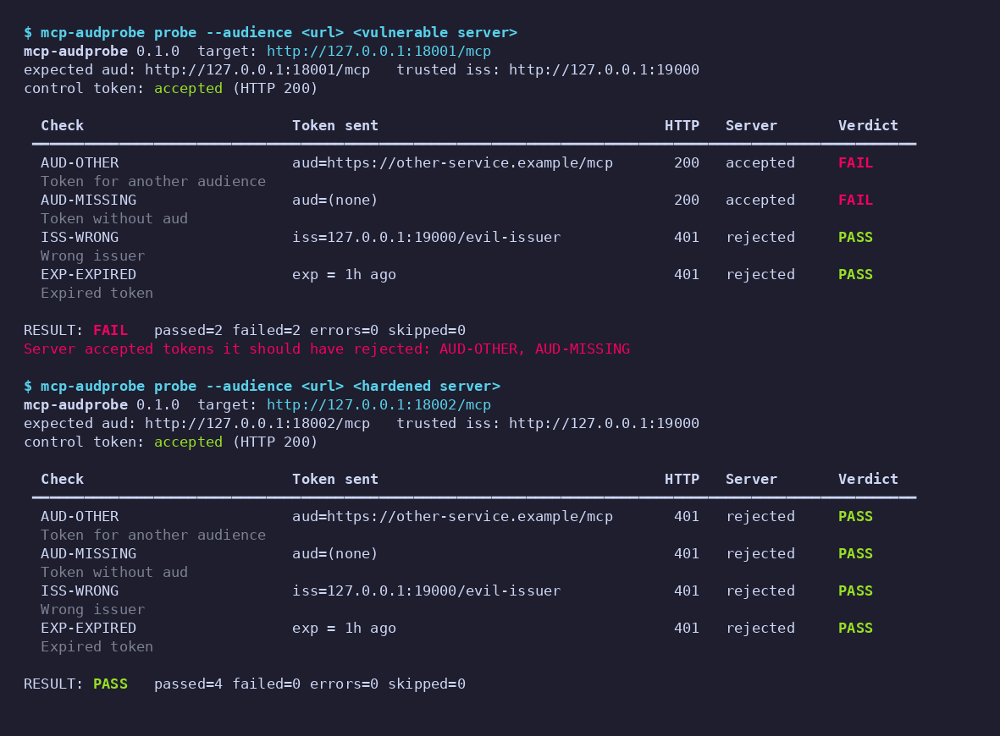

# mcp-audprobe

Actively test whether an **MCP server you own** really validates the bearer token's audience (`aud`),
issuer (`iss`) and expiry (`exp`). It mints test tokens with a local fake authorization server key,
sends them to your server, and reports **FAIL** if a token that must be rejected is accepted.

> ## ⚠️ Only test servers you own or are authorized to test
> `mcp-audprobe` sends authenticated requests with deliberately invalid tokens. Use it **only** against
> servers you operate or have explicit written permission to test. By default the CLI refuses any target
> that is not on loopback (`localhost`, `127.0.0.0/8`, `::1`); `--allow-remote` exists solely for your own
> staging/test deployments. Never point it at someone else's server. The demo and test-suite only talk to
> servers they start on `127.0.0.1`.

## The problem

A resource server must accept only tokens issued *for it*. Two recent advisories show servers that checked
signature, issuer and expiry but not the audience, so a valid token for a *different* service of the same
authorization server was accepted:

- MCP Python SDK: [GHSA-w4fh-qvv9-3v23](https://github.com/modelcontextprotocol/python-sdk/security/advisories/GHSA-w4fh-qvv9-3v23)
  (CVE-2026-116684, medium). Affected `mcp` 1.10.0–1.29.1 and 2.0.0–2.1.1; fixed in 1.30.0 / 2.2.0.
  **Upgrading alone changes nothing**: the patched versions add `AuthSettings(validate_token_resource=...)`,
  which is off unless set. To enable the check you must (1) set `validate_token_resource=True` with
  `resource_server_url` = the audience your authorization server puts in tokens for your server, **and**
  (2) return the token's audience from `TokenVerifier.verify_token()` as `AccessToken.resource`. With only
  the first change every request gets 401. (Confirmed against the advisory text and `mcp` 1.30.0 source:
  `mcp/server/auth/settings.py`, `mcp/server/auth/middleware/bearer_auth.py`.)
- AWS API MCP Server: [GHSA-4prq-p2x5-w9fh](https://github.com/awslabs/mcp/security/advisories/GHSA-4prq-p2x5-w9fh)
  (CVE-2026-115413, high). `awslabs.aws-api-mcp-server` >=1.3.0, <1.6.0 (streamable-http + OAuth) validated
  signature, issuer and expiry but not the audience/client; fixed in 1.6.0, which requires operators to set an
  expected audience or client ID.

Context: [thread](https://x.com/karlmehta/status/2115834904739033160). A config setting that is "off unless
you set it" is easy to miss, hence an *active* test that you can run in CI.

## Install

```bash
pip install -e .            # CLI only (Python >= 3.10)
pip install -e ".[demo]"    # + MCP Python SDK (>=1.30.0) and Pillow, for the demo servers / PNG
pip install -e ".[test]"    # + pytest
```

## How it works

1. `mcp-audprobe auth-server` runs a **fake authorization server** on loopback: RS256 JWKS at
   `/.well-known/jwks.json` plus OIDC/OAuth metadata. The RSA key is generated locally into `--key-file`.
2. Your server under test is configured to trust that issuer/JWKS (in CI/dev only!).
3. `mcp-audprobe probe` signs tokens with the same key file and sends each one as
   `Authorization: Bearer …` on an MCP JSON-RPC `initialize` request (`POST`, `Accept: application/json, text/event-stream`).

| # | Check id | Token | Must be |
|---|----------|-------|---------|
| 0 | `CONTROL` | valid: correct iss, aud, signature, exp | **accepted**, else the run is `INCONCLUSIVE` (attack checks are `SKIPPED`) |
| 1 | `AUD-OTHER` | valid signature/iss/exp, `aud` = another service | rejected |
| 2 | `AUD-MISSING` | valid signature/iss/exp, **no** `aud` claim | rejected |
| 3 | `ISS-WRONG` | signed with the trusted key, `iss` ≠ trusted issuer (isolates the `iss` check) | rejected |
| 4 | `EXP-EXPIRED` | valid otherwise, `exp` one hour in the past | rejected |

**Definition of "accepted"**: an HTTP **2xx** response to the authenticated request. **Rejected** = **401 or 403**.
Anything else (other 4xx/5xx, redirects, network error/timeout) is "unexpected": the control then makes the run
`INCONCLUSIVE`, and for an attack token the check is `ERROR`. Verdicts: accepted → `FAIL`, rejected → `PASS`.

Overall result / exit code: `PASS` (0), `FAIL` (1, any attack token accepted), `INCONCLUSIVE` (2, control not
accepted or an `ERROR`), usage/safety error (3).

## Usage

```bash
# 1. fake authorization server (creates key.pem if missing; keep it out of git)
mcp-audprobe auth-server --port 9000 --issuer http://127.0.0.1:9000 --key-file key.pem &

# 2. start your MCP server so it trusts issuer http://127.0.0.1:9000 and JWKS
#    http://127.0.0.1:9000/.well-known/jwks.json  (fetched lazily; see demo/demo_server.py)

# 3. probe
mcp-audprobe probe http://127.0.0.1:8001/mcp \
  --audience http://127.0.0.1:8001/mcp \
  --issuer http://127.0.0.1:9000 --key-file key.pem \
  --auth-server http://127.0.0.1:9000      # optional: verify the AS serves our key id first
```

Options: `--json` (JSON on stdout instead of the table), `--json-out FILE` (table *and* JSON file),
`--other-audience URL`, `--timeout S`, `--no-color`, `--allow-remote`. `python -m mcp_audprobe` also works.

## CI / GitHub Action

`action.yml` (composite) installs the tool, starts the fake auth server in the background, probes, writes
`audprobe-report.json`, stops the auth server, and fails the job on FAIL/INCONCLUSIVE. Your server must be
started in an earlier step on loopback, trusting `http://127.0.0.1:9000` (default `auth-port`).
See [`examples/audprobe-workflow.yml`](examples/audprobe-workflow.yml). Inputs: `url`, `audience`, `auth-port`,
`issuer`, `other-audience`, `json-output`, `allow-remote`, `python-version`; outputs: `result`, `report`.
Not published anywhere yet. Until it is, reference it by a local path (`uses: ./`) in a repo that contains it.

## JSON schema (`schema_version: 1`)

```jsonc
{
  "schema_version": 1, "tool": "mcp-audprobe", "tool_version": "0.1.0",
  "target": "http://127.0.0.1:18001/mcp", "expected_audience": "…", "other_audience": "…", "issuer": "…",
  "request": "POST initialize (JSON-RPC) with Authorization: Bearer <token>",
  "control": { "id": "CONTROL", "name": "…", "description": "…",
               "token_claims": {"iss": "…", "aud": "…", "exp": 0},   // aud absent when not sent
               "aud_present": true, "http_status": 200 /* null on network error */,
               "outcome": "accepted" /* accepted|rejected|unexpected */, "error": null, "accepted": true },
  "checks": [ { "id": "AUD-OTHER" /* AUD-OTHER|AUD-MISSING|ISS-WRONG|EXP-EXPIRED */, "name": "…", "description": "…",
                "token_claims": {…}, "aud_present": true, "http_status": 200,
                "outcome": "accepted" /* null when SKIPPED */,
                "verdict": "FAIL" /* PASS|FAIL|ERROR|SKIPPED */, "error": null } ],
  "summary": { "passed": 2, "failed": 2, "errors": 0, "skipped": 0 },
  "result": "FAIL",              // PASS | FAIL | INCONCLUSIVE
  "exit_code": 1
}
```

Raw tokens are never written to the report. Field names and order are stable within a `schema_version`.

## Demo

```bash
pip install -e ".[demo]"   # or: make install
./demo/run_demo.sh         # or: make demo
```

Starts the fake auth server and two real MCP Python SDK servers (`demo/demo_server.py`) on 127.0.0.1,
probes both, saves everything to `demo/output/` (`*.txt`, `*.json`, `demo.png`), then stops all processes.

- **vulnerable**: verifies signature, `iss`, `exp`, not `aud`; `validate_token_resource=False`; `verify_token()`
  does not set `AccessToken.resource`.
- **hardened**: same verifier, but `verify_token()` returns the token's `aud` as `AccessToken.resource` and
  `AuthSettings(validate_token_resource=True, resource_server_url=<its own URL>)`.



Expected: vulnerable = FAIL (`AUD-OTHER`, `AUD-MISSING` accepted), hardened = PASS. The vulnerable server still
rejects wrong-`iss` and expired tokens: exactly the AWS advisory's description (signature, issuer and expiry
checked, audience not). Tests: `pytest` (unit tests for minting and verdict logic, mocked-transport probe
tests, and an end-to-end test against both demo servers).

## Limitations

- Black-box, HTTP-level only: it observes status codes, not why a server rejected a token. A 401 for an unrelated
  reason (e.g. server cannot fetch JWKS) looks like a pass for attack checks; the `CONTROL` token guards against
  the "rejects everything" case.
- Your server must be configured to trust the fake issuer/JWKS. Run it against a dev/CI configuration of the
  *same code*, not production with real trust anchors; a production config will reject the control token
  (→ `INCONCLUSIVE`).
- Tests the audience as an exact string/URL you provide. Servers that accept several audiences or list-valued
  `aud`, scope/client-ID based checks (e.g. Cognito `client_id`), opaque (non-JWT) tokens, DPoP and
  mTLS-bound tokens are not covered.
- The wrong-`iss` token uses the trusted key, so it tests the `iss` comparison, not key/issuer binding.
- Uses `initialize` only. Servers that enforce auth later (per tool call) or need sessions may need more.
- Clock skew leeway on the server is not probed (expired token is 1 h old).
- Demo servers are for demonstration, not production templates. Developed against `mcp` 1.30.0.

## Comparison with authgent

[authgent](https://github.com/authgent/authgent) (Apache-2.0) was read on 2026-11-01 (README,
`docs/methodology.md`, `server/authgent_server/scanner.py`, read-only). Its `authgent-server lint <mcp-url>`
is an MCP-OAuth **conformance scanner**: it inspects discovery metadata (RFC 9728 protected resource metadata,
RFC 8414 AS metadata), advertised capabilities (PKCE methods, RFC 8707 resource indicators, DCR, `iss`
parameter, …), plus a few probes of the authorization server (PKCE `plain` at `/authorize`, duplicate DCR
registrations) and a heuristic `GET /`. Its `MCP-AUD-001` only checks that the AS **advertises**
`resource_indicators_supported`.

**Based on that review, authgent does not appear to submit forged or mis-audienced bearer tokens to the MCP
resource server, so it does not perform this active `aud`/`iss`/`exp` acceptance test.** It can tell you the AS
*supports* resource indicators; it cannot tell you whether your server *rejects* a token minted for another
audience, which is the failure in the two advisories above. The tools are complementary: authgent audits
metadata/spec conformance of a (possibly remote) server and also ships an AS and SDKs; mcp-audprobe is a narrow
black-box test of token validation on servers you run locally with a throwaway fake issuer. (I did not audit
authgent's own SDK middleware, nor verify claims beyond the files named above; its behaviour may change.)

## License

MIT, see [LICENSE](LICENSE).
