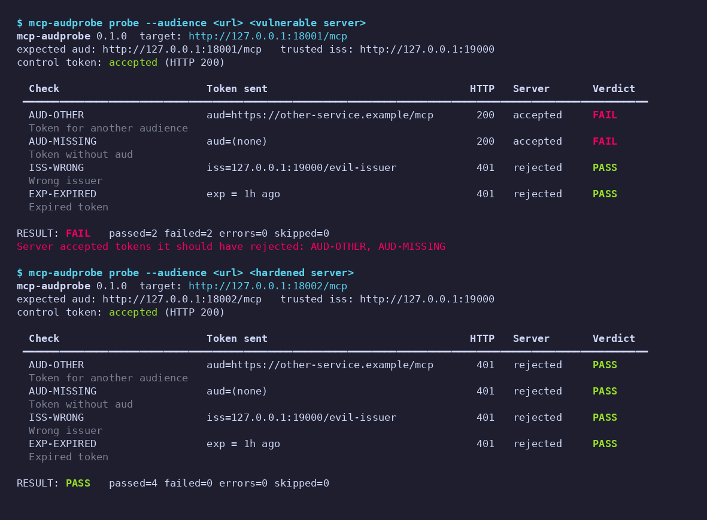

[English](README.md) | **Türkçe**

[](https://github.com/bymustfa/mcp-audprobe/actions/workflows/ci.yml)

# mcp-audprobe

**Kendi işlettiğiniz bir MCP sunucusunun** bearer token içindeki hedef kitle (`aud`), yayıncı (`iss`) ve
son kullanma (`exp`) alanlarını gerçekten doğrulayıp doğrulamadığını *aktif olarak* test edin. Araç, yerel bir
sahte yetkilendirme sunucusunun anahtarıyla test token'ları üretir, bunları sunucunuza gönderir ve reddedilmesi
gereken bir token kabul edilirse **FAIL** raporlar.

> ## ⚠️ Yalnızca sahibi olduğunuz veya test etme yetkiniz bulunan sunucuları test edin
> `mcp-audprobe`, kasıtlı olarak geçersiz token'larla kimlik doğrulamalı istekler gönderir. Yalnızca kendi
> işlettiğiniz veya test için açık (yazılı) izin aldığınız sunucularda kullanın. CLI varsayılan olarak loopback
> dışındaki (`localhost`, `127.0.0.0/8`, `::1`) hedefleri reddeder; `--allow-remote` yalnızca kendi
> staging/test ortamlarınız içindir. Başkasının sunucusuna asla yöneltmeyin. Demo ve test paketi de yalnızca
> `127.0.0.1` üzerinde kendi başlattıkları sunucularla konuşur.

## Sorun nedir?

Bir kaynak sunucusu (resource server) yalnızca *kendisi için* üretilmiş token'ları kabul etmelidir. İki yakın
tarihli güvenlik bülteni, imzayı, `iss`'i ve süreyi kontrol edip hedef kitleyi kontrol etmeyen sunucuları
gösteriyor. Sonuç olarak aynı yetkilendirme sunucusunun başka bir servis için ürettiği geçerli bir token
kabul ediliyordu:

- MCP Python SDK: [GHSA-w4fh-qvv9-3v23](https://github.com/modelcontextprotocol/python-sdk/security/advisories/GHSA-w4fh-qvv9-3v23)
  (CVE-2026-116684, orta). Etkilenen `mcp` sürümleri: 1.10.0–1.29.1 ve 2.0.0–2.1.1; düzeltme 1.30.0 / 2.2.0.
  **Yalnızca sürüm yükseltmek hiçbir şeyi değiştirmez**: yamalı sürümler `AuthSettings(validate_token_resource=...)`
  ayarını ekler ve bu ayar siz açmadıkça kapalıdır. Kontrolü etkinleştirmek için (1) `validate_token_resource=True`
  yapıp `resource_server_url` değerini yetkilendirme sunucunuzun sizin sunucunuz için token'a yazdığı hedef kitleye
  eşitlemeniz **ve** (2) `TokenVerifier.verify_token()` içinden token'ın hedef kitlesini `AccessToken.resource`
  olarak döndürmeniz gerekir. Yalnızca birincisini yaparsanız her istek 401 alır. (Bülten metni ve `mcp` 1.30.0
  kaynak kodu ile doğrulandı: `mcp/server/auth/settings.py`, `mcp/server/auth/middleware/bearer_auth.py`.)
- AWS API MCP Server: [GHSA-4prq-p2x5-w9fh](https://github.com/awslabs/mcp/security/advisories/GHSA-4prq-p2x5-w9fh)
  (CVE-2026-115413, yüksek). `awslabs.aws-api-mcp-server` >=1.3.0, <1.6.0 (streamable-http + OAuth) imzayı,
  yayıncıyı ve süreyi doğruluyor ama hedef kitleyi/istemciyi doğrulamıyordu; düzeltme 1.6.0 sürümünde ve bu sürüm,
  operatörlerin beklenen bir hedef kitle veya client ID tanımlamasını zorunlu kılıyor.

Bağlam: [X paylaşımı](https://x.com/karlmehta/status/2115834904739033160). "Siz açmadıkça kapalı" olan bir ayarı
gözden kaçırmak kolaydır; bu yüzden CI'da çalıştırabileceğiniz *aktif* bir test gerekir.

## Kurulum

```bash
pip install -e .            # yalnızca CLI (Python >= 3.10)
pip install -e ".[demo]"    # + MCP Python SDK (>=1.30.0,<2) ve Pillow (demo sunucuları / PNG için)
pip install -e ".[test]"    # + pytest, ruff
```

## Nasıl çalışır?

1. `mcp-audprobe auth-server`, loopback üzerinde **sahte bir yetkilendirme sunucusu** çalıştırır:
   `/.well-known/jwks.json` adresinde RS256 JWKS ve OIDC/OAuth metadata sunar. RSA anahtarı yerelde
   `--key-file` dosyasına üretilir.
2. Test edilen sunucunuz bu yayıncıya/JWKS'e güvenecek şekilde yapılandırılır (yalnızca CI/geliştirmede!).
3. `mcp-audprobe probe`, aynı anahtar dosyasıyla token imzalar ve her birini MCP JSON-RPC `initialize` isteğinde
   (`POST`, `Accept: application/json, text/event-stream`) `Authorization: Bearer …` başlığıyla gönderir.

| # | Kontrol kimliği | Token | Beklenen |
|---|-----------------|-------|----------|
| 0 | `CONTROL` | geçerli: doğru iss, aud, imza, exp | **kabul**; aksi halde sonuç `INCONCLUSIVE` olur (saldırı kontrolleri `SKIPPED`) |
| 1 | `AUD-OTHER` | imza/iss/exp geçerli, `aud` = başka bir servis | red |
| 2 | `AUD-MISSING` | imza/iss/exp geçerli, `aud` alanı **hiç yok** | red |
| 3 | `ISS-WRONG` | güvenilen anahtarla imzalı, `iss` ≠ güvenilen yayıncı (yalnızca `iss` kontrolünü izole eder) | red |
| 4 | `EXP-EXPIRED` | diğer her şey geçerli, `exp` bir saat geçmişte | red |

**"Kabul edildi" tanımı**: kimliği doğrulanmış isteğe verilen HTTP **2xx** yanıtı. **Reddedildi** = **401 veya
403**. Geri kalan her şey (diğer 4xx/5xx, yönlendirme, ağ hatası/zaman aşımı) "beklenmedik" sayılır: kontrol
token'ında olursa sonuç `INCONCLUSIVE` olur, saldırı token'ında olursa o kontrol `ERROR` olur.
Hükümler: kabul edildi → `FAIL`, reddedildi → `PASS`.

Genel sonuç / çıkış kodu: `PASS` (0), `FAIL` (1, bir saldırı token'ı kabul edildi), `INCONCLUSIVE` (2, kontrol
token'ı kabul edilmedi veya bir `ERROR` var), kullanım/güvenlik hatası (3).

## Kullanım

```bash
# 1. sahte yetkilendirme sunucusu (key.pem yoksa oluşturur; git'e eklemeyin)
mcp-audprobe auth-server --port 9000 --issuer http://127.0.0.1:9000 --key-file key.pem &

# 2. MCP sunucunuzu, yayıncı http://127.0.0.1:9000 ve JWKS
#    http://127.0.0.1:9000/.well-known/jwks.json adresine güvenecek şekilde başlatın
#    (JWKS ilk istekte alınır; bkz. demo/demo_server.py)

# 3. probe
mcp-audprobe probe http://127.0.0.1:8001/mcp \
  --audience http://127.0.0.1:8001/mcp \
  --issuer http://127.0.0.1:9000 --key-file key.pem \
  --auth-server http://127.0.0.1:9000      # isteğe bağlı: önce AS'nin anahtar kimliğimizi sunduğunu doğrular
```

Seçenekler: `--json` (tablo yerine stdout'a JSON), `--json-out DOSYA` (hem tablo hem JSON dosyası),
`--other-audience URL`, `--timeout SN`, `--no-color`, `--allow-remote`. `python -m mcp_audprobe` de çalışır.

## CI / GitHub Action

`action.yml` (composite), aracı kurar, sahte yetkilendirme sunucusunu arka planda başlatır, probe çalıştırır,
`audprobe-report.json` dosyasını yazar, yetkilendirme sunucusunu durdurur ve FAIL/INCONCLUSIVE durumunda işi
başarısız kılar. Sunucunuz daha önceki bir adımda loopback üzerinde başlatılmış ve `http://127.0.0.1:9000`
adresine güvenecek şekilde ayarlanmış olmalıdır (varsayılan `auth-port`). Bkz.
[`examples/audprobe-workflow.yml`](examples/audprobe-workflow.yml). Girdiler: `url`, `audience`, `auth-port`,
`issuer`, `other-audience`, `json-output`, `allow-remote`, `python-version`; çıktılar: `result`, `report`.
Action henüz bir marketplace'te yayımlanmadı; bu depodan `uses: bymustfa/mcp-audprobe@main` veya yerel olarak
`uses: ./` ile kullanabilirsiniz.

## JSON şeması (`schema_version: 1`)

```jsonc
{
  "schema_version": 1, "tool": "mcp-audprobe", "tool_version": "0.1.0",
  "target": "http://127.0.0.1:18001/mcp", "expected_audience": "…", "other_audience": "…", "issuer": "…",
  "request": "POST initialize (JSON-RPC) with Authorization: Bearer <token>",
  "control": { "id": "CONTROL", "name": "…", "description": "…",
               "token_claims": {"iss": "…", "aud": "…", "exp": 0},   // gönderilmediğinde aud yoktur
               "aud_present": true, "http_status": 200 /* ağ hatasında null */,
               "outcome": "accepted" /* accepted|rejected|unexpected */, "error": null, "accepted": true },
  "checks": [ { "id": "AUD-OTHER" /* AUD-OTHER|AUD-MISSING|ISS-WRONG|EXP-EXPIRED */, "name": "…", "description": "…",
                "token_claims": {…}, "aud_present": true, "http_status": 200,
                "outcome": "accepted" /* SKIPPED ise null */,
                "verdict": "FAIL" /* PASS|FAIL|ERROR|SKIPPED */, "error": null } ],
  "summary": { "passed": 2, "failed": 2, "errors": 0, "skipped": 0 },
  "result": "FAIL",              // PASS | FAIL | INCONCLUSIVE
  "exit_code": 1
}
```

Ham token'lar rapora asla yazılmaz. Alan adları ve sırası, bir `schema_version` içinde sabittir.

## Demo

```bash
pip install -e ".[demo]"   # veya: make install
./demo/run_demo.sh         # veya: make demo
```

Sahte yetkilendirme sunucusunu ve gerçek MCP Python SDK ile yazılmış iki sunucuyu (`demo/demo_server.py`)
127.0.0.1 üzerinde başlatır, ikisini de test eder, her şeyi `demo/output/` altına kaydeder (`*.txt`, `*.json`,
`demo.png`) ve tüm süreçleri durdurur.

- **vulnerable (savunmasız)**: imzayı, `iss`'i ve `exp`'i doğrular, `aud`'u doğrulamaz;
  `validate_token_resource=False`; `verify_token()` `AccessToken.resource` alanını doldurmaz.
- **hardened (sertleştirilmiş)**: aynı doğrulayıcı, ancak `verify_token()` token'ın `aud` değerini
  `AccessToken.resource` olarak döndürür ve
  `AuthSettings(validate_token_resource=True, resource_server_url=<kendi URL'si>)` ayarlıdır.



Beklenen: vulnerable = FAIL (`AUD-OTHER`, `AUD-MISSING` kabul edildi), hardened = PASS. Savunmasız sunucu yine
de yanlış `iss`'li ve süresi dolmuş token'ları reddeder; bu, AWS bülteninin tarifiyle birebir uyumludur (imza,
yayıncı ve süre kontrol ediliyor, hedef kitle edilmiyor). Testler: `pytest` (token üretimi ve hüküm mantığı için
birim testleri, sahte transport ile probe testleri ve iki demo sunucusuna karşı uçtan uca test).

## Sınırlamalar

- Kara kutu ve yalnızca HTTP düzeyinde çalışır: durum kodlarını görür, sunucunun token'ı *neden* reddettiğini
  görmez. İlgisiz bir nedenle gelen 401 (örneğin sunucu JWKS'i alamıyor) saldırı kontrollerinde "geçti" gibi
  görünür; `CONTROL` token'ı, "her şeyi reddeden" duruma karşı koruma sağlar.
- Sunucunuz sahte yayıncıya/JWKS'e güvenecek şekilde yapılandırılmış olmalıdır. Gerçek güven kökleri olan
  production'a değil, *aynı kodun* geliştirme/CI yapılandırmasına karşı çalıştırın; production yapılandırması
  kontrol token'ını reddeder (→ `INCONCLUSIVE`).
- Hedef kitleyi, sizin verdiğiniz tam string/URL olarak test eder. Birden çok hedef kitle kabul eden veya liste
  değerli `aud` kullanan sunucular, kapsam/istemci kimliği tabanlı kontroller (ör. Cognito `client_id`), opak
  (JWT olmayan) token'lar, DPoP ve mTLS'e bağlı token'lar kapsam dışıdır.
- Yanlış `iss` token'ı güvenilen anahtarla imzalanır; yani `iss` karşılaştırmasını test eder, anahtar/yayıncı
  bağlamasını değil.
- Yalnızca `initialize` kullanır. Kimlik doğrulamayı daha sonra (araç çağrısı başına) uygulayan veya oturum
  gerektiren sunucular için daha fazlası gerekebilir.
- Sunucudaki saat sapması toleransı (clock skew leeway) test edilmez (süresi dolmuş token 1 saat eskidir).
- Demo sunucuları gösterim içindir, production şablonu değildir. `mcp` 1.30.0 ile geliştirildi; demo sunucuları 1.x `FastMCP` API'sini kullanır (`mcp>=1.30.0,<2`; `mcp` 2.x bunu yeniden adlandırdı ve demo henüz 2.x'i desteklemiyor).

## authgent ile karşılaştırma

[authgent](https://github.com/authgent/authgent) (Apache-2.0) 2026-11-01 tarihinde salt okunur olarak incelendi
(README, `docs/methodology.md`, `server/authgent_server/scanner.py`). `authgent-server lint <mcp-url>` komutu bir
MCP-OAuth **uyumluluk tarayıcısıdır**: keşif metadata'sını (RFC 9728 korumalı kaynak metadata'sı, RFC 8414 AS
metadata'sı), ilan edilen yetenekleri (PKCE yöntemleri, RFC 8707 kaynak göstergeleri, DCR, `iss` parametresi
vb.), yetkilendirme sunucusuna yönelik birkaç yoklamayı (`/authorize` üzerinde PKCE `plain`, yinelenen DCR
kayıtları) ve sezgisel bir `GET /` kontrolünü inceler. `MCP-AUD-001` kontrolü yalnızca AS'nin
`resource_indicators_supported` değerini **ilan edip etmediğine** bakar.

**Bu incelemeye göre authgent, MCP kaynak sunucusuna sahte veya yanlış hedef kitleli bearer token göndermiyor
görünüyor; dolayısıyla bu aktif `aud`/`iss`/`exp` kabul testini yapmıyor.** AS'nin kaynak göstergelerini
*desteklediğini* söyleyebilir, ancak sunucunuzun başka bir hedef kitle için üretilmiş token'ı *reddedip
reddetmediğini* söyleyemez; yukarıdaki iki bültendeki hata tam olarak budur. İki araç birbirini tamamlar:
authgent (uzak olabilen) bir sunucunun metadata/spesifikasyon uyumluluğunu denetler, ayrıca bir AS ve SDK'lar
sunar; mcp-audprobe ise tek kullanımlık sahte bir yayıncıyla yerelde çalıştırdığınız sunucuların token
doğrulamasını test eden dar kapsamlı bir kara kutu testidir. (authgent'in kendi SDK middleware'ini
denetlemedim ve yukarıda adı geçen dosyaların dışında bir iddiayı doğrulamadım; davranışı değişebilir.)

## Katkı

[CONTRIBUTING.md](CONTRIBUTING.md), [Davranış Kuralları](CODE_OF_CONDUCT.md) ve [Güvenlik Politikası](SECURITY.md)
dosyalarına bakın.

## Lisans

MIT, bkz. [LICENSE](LICENSE).
